<h1 align="center">Naufal Shidqi</h1>

  <b>Backend Engineer · System Architect · Technical Lead</b> 
  I design and build backends, distributed systems, and AI-powered platforms — from zero to production.

  
  
  

---

## About

I'm a backend-focused engineer based in Indonesia. Most of my work lives in
private repositories: production platforms with multi-tenant architecture,
background job processing, workflow automation, and LLM integrations.

I care about software that is **maintainable, scalable, observable, and
reliable** — clean architecture, well-designed APIs, and infrastructure that
holds up in production. I also have an academic background in NLP, with
published research on chatbot systems.

Outside of tech, I play guitar. 🎸

---

## Featured Projects

| Project | What it is |
| --- | --- |
| **SwitchSend** | Workflow automation platform |
| **Mauvie** | Multi-tenant website builder |
| **[Pibien](https://pibien.com)** | AI content platform |
| **Plagse** | AI text processing platform |

---

## Tech Stack

| Area | Tools |
| --- | --- |
| **Languages** |      |
| **Backend** |      |
| **Data & Messaging** |     |
| **DevOps & Cloud** |        |
| **AI & Data** |      |
| **Automation** |       |

**Practices:** microservices · clean architecture · RESTful API design ·
task queues & job scheduling · multi-tenant architecture · LLM integration

---

## GitHub Activity

  
  

<i>Build systems. Solve problems. Ship to production.</i>

